# Meteosphere

A weather app for Android with a live sky, the Moon, the Sun and earthquakes. Everything is made right on the
phone from public data services: no account, no ads, no analytics.

<p align="center">
  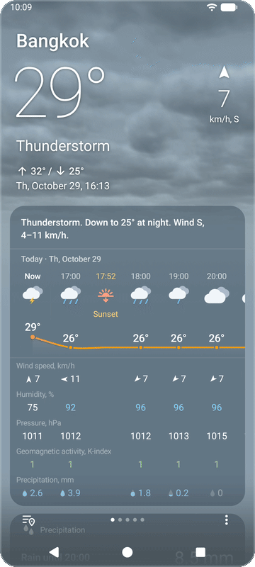
  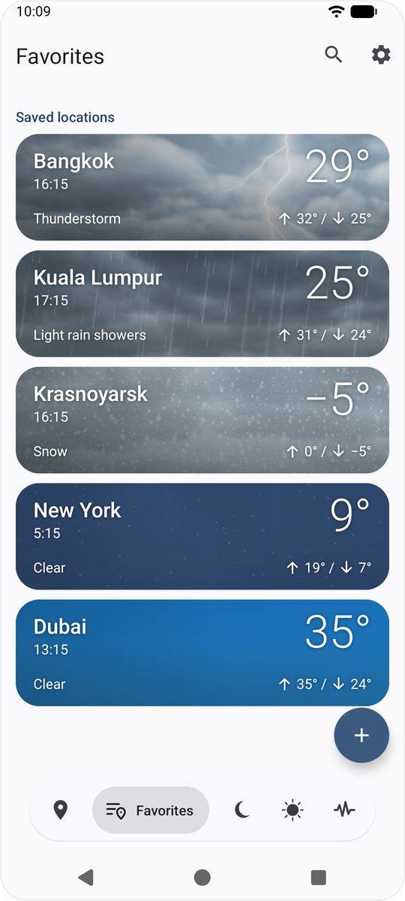
  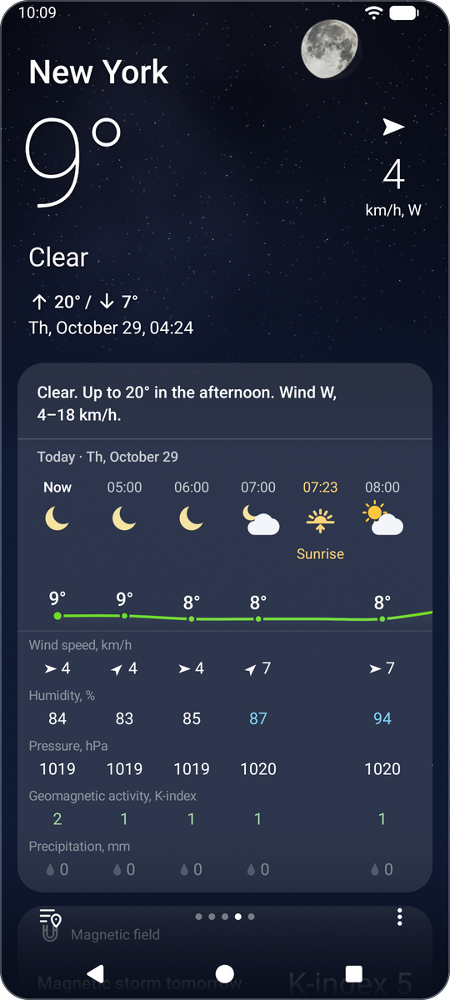
</p>

<p align="center">
  <a href="https://github.com/meteo-sphere/meteosphere/releases/latest"><b>Download the APK</b></a> · Android 7.0 or newer ·
  <a href="https://github.com/meteo-sphere/meteosphere/actions/workflows/build.yml"></a>
</p>

## Download

The APK of each version is on the [Releases](https://github.com/meteo-sphere/meteosphere/releases) page, built by
GitHub Actions and signed with the project's key, so a new version installs over the one before. Android 7.0 or newer
runs it.

## Features

**Weather**
- Places nearby, found by the phone's location, and your favourite places, in any order.
- The weather now, the forecast by hours and by days, and the details: wind, humidity and dew point, pressure and
  where it is going, precipitation over the coming week, the geomagnetic K-index, the strongest earthquake of the day.
- An animated sky behind the weather, drawn on the GPU with shaders: drifting clouds, rain, snow, thunderstorms with
  lightning, stars and the real Moon, lit and turned as it is seen from the place. It needs Android 13 or newer and
  can be turned off in the settings to save the battery.

<p align="center">
  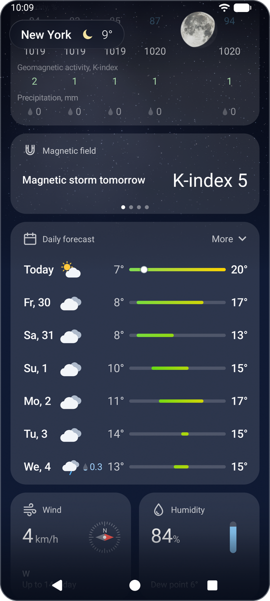
  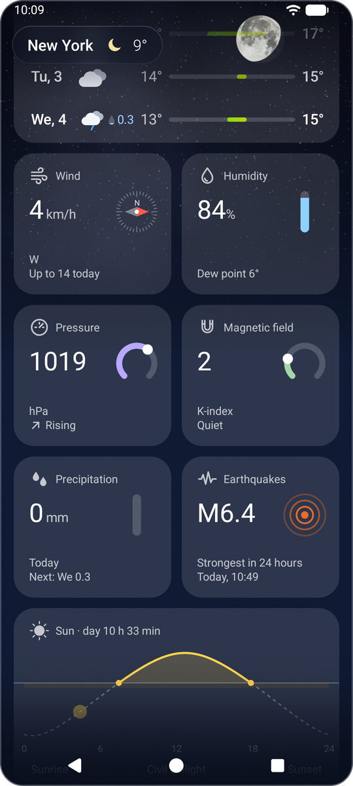
</p>

**Moon**: the phase, the illumination and the age, moonrise and moonset, the next phases, the light over the month,
perigee, apogee and supermoons.

<p align="center">
  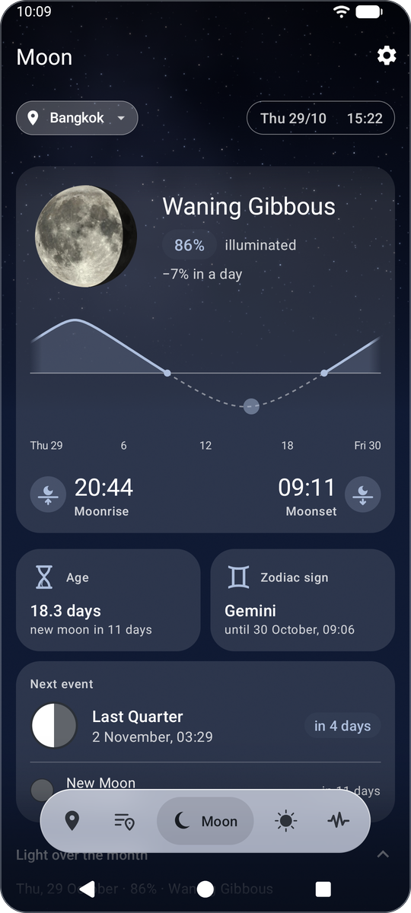
</p>

**Sun**: sunrise and sunset, the length of the day over the day and the year, solstices and equinoxes, solar and lunar
eclipses up to 2100 with what is seen from the place, and **The Sun now**: pictures of the Sun over the last
24 hours in seven channels, six from NASA's Solar Dynamics Observatory and the corona from SOHO.

<p align="center">
  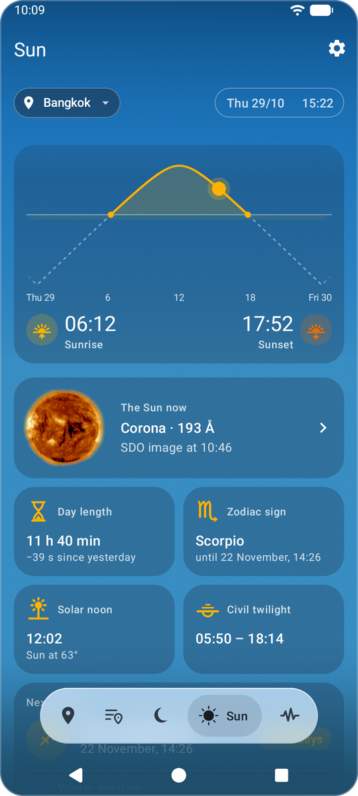
  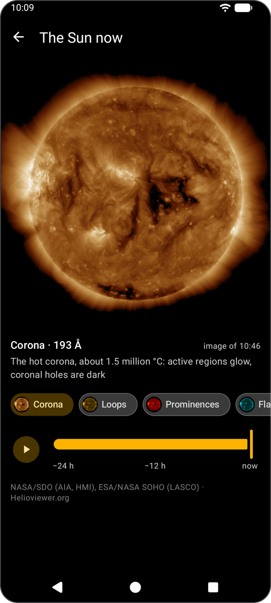
</p>

**Earthquakes**: M5+ earthquakes worldwide from USGS for a day, a week or a month, on a map, by time or by distance
from your place.

<p align="center">
  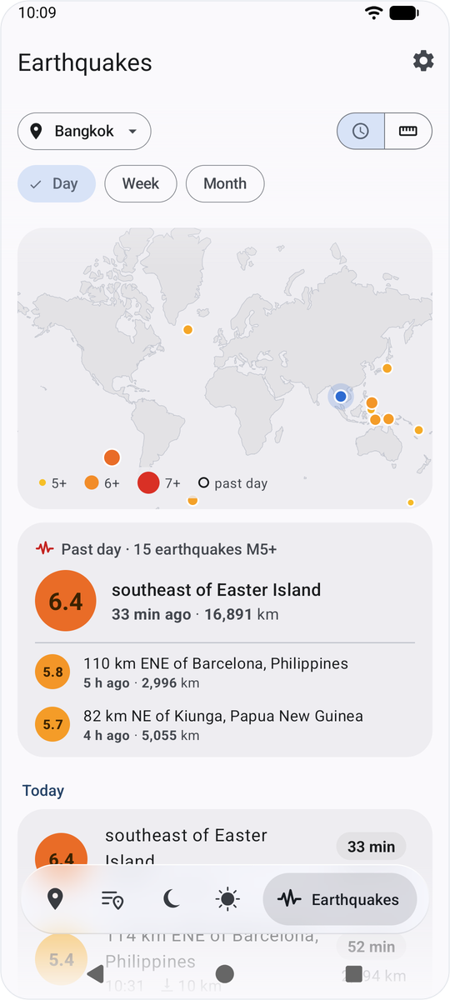
  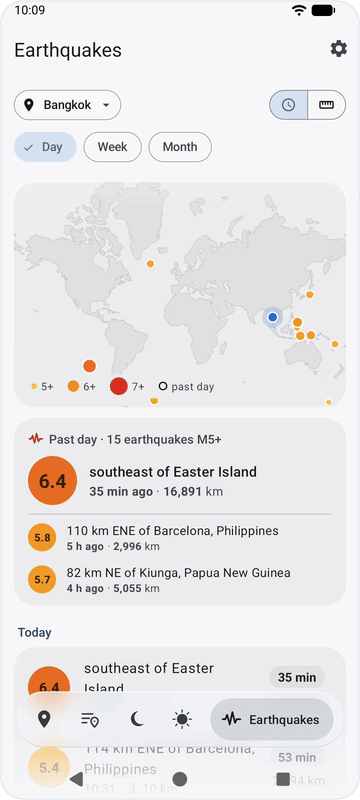
</p>

**Widgets**
- 1×1 icon and temperature
- 2×1 the weather now and the next hours or days
- 4×1 the weather now and the forecast in a row
- 4×2 and 4×3 a chart of the hours or the days, the 4×3 also with the date and a clock over it
- 4×2 the weather now with the date and a clock
- Moon, Sun and Earthquakes

<p align="center">
  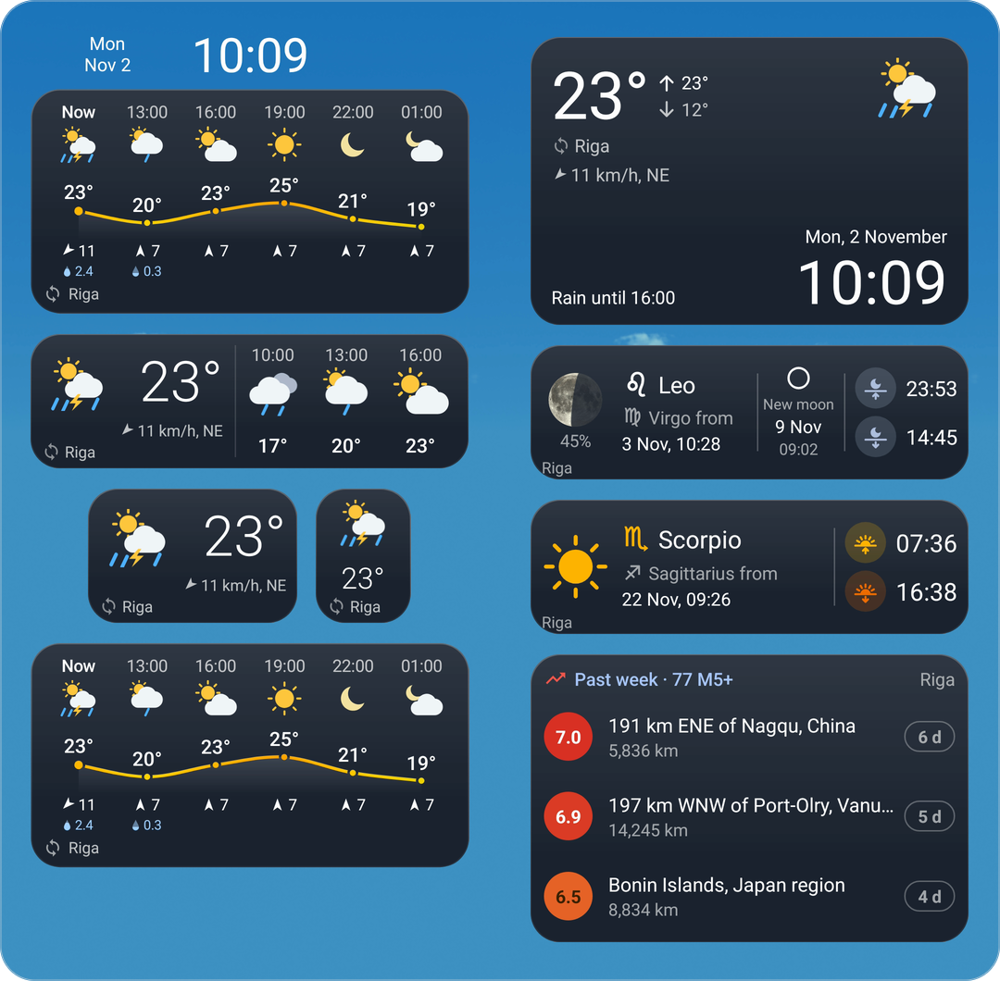
</p>

**Notifications**: the weather in the status bar, the forecast for the day, strong earthquakes worldwide and M5+ ones
near your places, moon phases and eclipses. The moon phases and the eclipses keep quiet at night.

**Also**: 14 languages (English, Russian, Ukrainian, Polish, German, French, Spanish, Italian, Portuguese, Turkish,
Simplified and Traditional Chinese, Japanese, Dutch), taken from Android, per app on Android 13+; units of measure;
light and dark themes; the main screen's tabs can be reordered and hidden; a chart of the requests to each data
source.

## Data sources

| Source | What for | Key |
| --- | --- | --- |
| [Open-Meteo](https://open-meteo.com) | Forecast and place search (the default source) | none |
| [Foreca](https://developer.foreca.com) | Forecast, if chosen in the settings | your own, asked for when you choose it |
| [GeoNames](https://www.geonames.org) | Places nearby: `cities1000.zip`, downloaded once (about 11 MB) | none |
| [NOAA SWPC](https://www.swpc.noaa.gov) | Geomagnetic K-index forecast | none |
| [USGS](https://earthquake.usgs.gov/fdsnws/event/1/) | Earthquakes | none |
| [Helioviewer](https://helioviewer.org) | The Sun now: NASA/SDO (AIA, HMI), ESA/NASA SOHO (LASCO) | none |

Foreca gives a free key after signing up on [developer.foreca.com](https://developer.foreca.com); the app checks it
before taking it.

The positions of the Sun and the Moon, their rising and setting and the moon phases are computed on the phone after
Jean Meeus, *Astronomical Algorithms*. Bundled with the app:
- eclipses 2025–2100 from NASA's Five Millennium Catalogs (Fred Espenak and Jean Meeus);
- the land of the earthquake map: [Natural Earth](https://www.naturalearthdata.com) 1:110m, public domain;
- the Moon's map: LRO's nearside from NASA's CGI Moon Kit, public domain;
- the clouds' noise, generated with Sébastien Hillaire's
  [TileableVolumeNoise](https://github.com/sebh/TileableVolumeNoise) (MIT), see `tools/sky_noise_atlas.py`.

## Building

You need the Android SDK with platform 37 (Android Studio writes its path to `local.properties`) and JDK 25.

```bash
./gradlew assembleDebug
```

The APK is `app/build/outputs/apk/debug/meteosphere-debug.apk`. Android 7.0 or newer runs it.

`./gradlew assembleRelease` makes a smaller, faster build shrunk by R8, `meteosphere-release.apk`. It is signed with
the local debug key, enough for installing it on your own phones; a key file named in the environment
(`RELEASE_KEYSTORE_FILE`, `RELEASE_KEYSTORE_PASSWORD`, `RELEASE_KEY_ALIAS`) signs it with that key instead.

A tag `vX.Y.Z` matching the version in `app/build.gradle` makes a release: `.github/workflows/build.yml` tests the
code, builds the APK, signs it with the key kept in the repository's secrets and puts it on the Releases page.

Unit tests:

```bash
./gradlew testDebugUnitTest
```

## Project layout

The app is Java on Android Views with Material 3 components, one module, `app`.

| Package | What is there |
| --- | --- |
| `data` | Weather providers: `local` asks Open-Meteo or Foreca; `quake` USGS, `sun` Helioviewer |
| `astro` | The Sun, the Moon and the eclipses |
| `ui` | The screens, the widgets, the animated sky (`ui/sky`), the frosted glass (`ui/glass`) |
| `background` | Updating the weather and the widgets, the notifications |
| `settings` | The settings and the places |

`tools/weather_icons.py` draws the weather icons as vector drawables; `tools/sky_noise_atlas.py` turns the cloud noise
into the textures in `res/raw`.

## How it was made

Meteosphere was written by Claude, Anthropic's AI, in Claude Code, under the direction of the author, who decided what
the app does and how it looks, chose the designs from the variants Claude showed and approved every plan before the
work began.

## Icons

The add, menu, search and tick icons are Google's [Material Icons](https://github.com/google/material-design-icons),
under the Apache License 2.0; the app's other icons that name a Material icon in their files are drawn after them.
